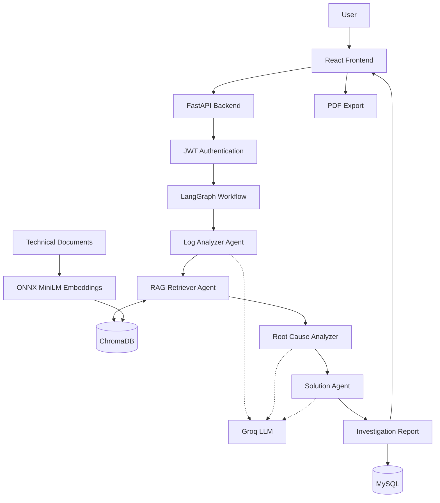
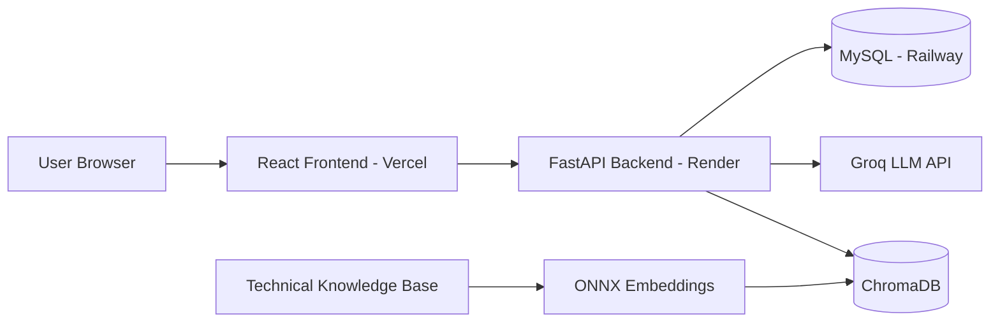
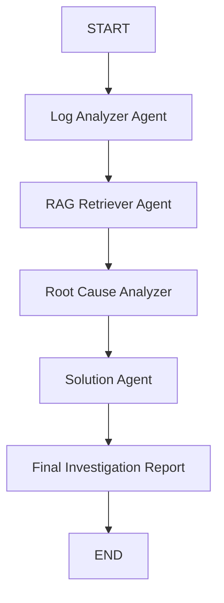
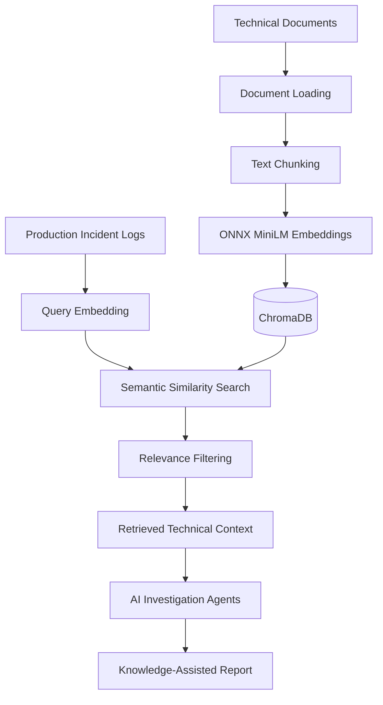

# 🛡️ SentinelAI

### AI-Powered Production Incident Investigation System


---

## 🌐 Live Demo

| Resource | Link |
|---|---|
| Live Application | [Open SentinelAI](https://sentinel-ai-nine-drab.vercel.app) |
| Backend API | [FastAPI Backend](https://sentinelai-dfg0.onrender.com) |
| API Documentation | [Swagger UI](https://sentinelai-dfg0.onrender.com/docs) |
| Backend Health | [Health Check](https://sentinelai-dfg0.onrender.com/health) |
| GitHub Repository | [Source Code](https://github.com/vivekkeskar/SentinelAI) |

Create an account or log in to explore the application and investigate sample production logs.

> Note: The backend is hosted on Render's free tier and may take some time to start after inactivity. Hosting quotas and database trial limits apply.

---

## 📌 Overview

SentinelAI is an AI-powered full-stack application designed to assist developers, DevOps engineers, and IT operations teams in investigating production incidents.

It analyzes application logs, retrieves relevant technical documentation, identifies potential root causes, and generates actionable resolution recommendations using a multi-agent AI workflow.

The platform combines Large Language Models (LLMs), Retrieval-Augmented Generation (RAG), semantic search, vector databases, and authenticated REST APIs.

SentinelAI helps transform unstructured production logs into structured, knowledge-assisted investigation reports.

---

## 🎯 Problem Statement

Traditional production incident investigation requires developers to manually analyze application logs, search technical documentation, identify root causes, and prepare investigation reports.

This process can be time-consuming, especially when dealing with complex production systems and large amounts of technical information.

SentinelAI automates key parts of this process using intelligent AI agents and knowledge-based retrieval.

The objective is to assist developers in investigating incidents more efficiently while distinguishing verified evidence from potential root cause hypotheses.

---

## 🚀 Key Features

- AI-powered production log analysis
- LangGraph multi-agent investigation workflow
- Retrieval-Augmented Generation (RAG)
- Lightweight ONNX MiniLM semantic embeddings
- ChromaDB vector database
- Potential root cause identification
- AI-generated resolution recommendations
- Smart knowledge base relevance filtering
- JWT-based authentication
- User registration and login
- User-specific incident history
- MySQL database persistence
- Knowledge base reference tracking
- Downloadable PDF investigation reports
- Responsive React dashboard
- REST API integration
- Interactive Swagger API documentation
- Automated functional and basic security testing
- Cloud deployment

---

## 🏗️ System Architecture



---

## ☁️ Cloud Deployment Architecture



### Deployment Platforms

| Component | Platform |
|---|---|
| Frontend | Vercel |
| Backend | Render |
| Relational Database | Railway MySQL |
| LLM Inference | Groq Cloud |
| Vector Database | ChromaDB |
| Source Code | GitHub |

The backend initializes its technical knowledge base before serving application requests.

The frontend communicates with the deployed FastAPI backend using REST APIs.

Sensitive credentials and configuration values are managed through environment variables.

---

## 🤖 Multi-Agent AI Workflow

SentinelAI uses LangGraph to coordinate four specialized agents.

| Agent | Responsibility |
|---|---|
| Log Analyzer Agent | Analyzes production logs and identifies error patterns |
| RAG Retriever Agent | Retrieves relevant technical documentation |
| Root Cause Analyzer | Identifies potential incident causes using logs and retrieved knowledge |
| Solution Agent | Generates troubleshooting and resolution recommendations |

### Agent Execution Flow



### 1. Log Analyzer Agent

- Identifies errors and warnings.
- Detects suspicious log patterns.
- Explains potential system impact.
- Suggests investigation areas.

### 2. RAG Retriever Agent

- Converts incident logs into semantic embeddings.
- Searches the ChromaDB knowledge base.
- Filters irrelevant technical documents.
- Provides relevant documentation to subsequent agents.

### 3. Root Cause Analyzer

- Analyzes logs and retrieved documentation.
- Identifies potential root causes.
- Explains supporting evidence.
- Distinguishes facts from hypotheses.
- Identifies missing diagnostic information.

### 4. Solution Agent

- Generates immediate mitigation recommendations.
- Suggests debugging and investigation steps.
- Recommends possible permanent fixes.
- Provides preventive measures.
- References relevant technical documentation.

---

## 🛠️ Technology Stack

| Category | Technology |
|---|---|
| Frontend | React.js, Vite |
| Backend | Python, FastAPI |
| AI Orchestration | LangGraph |
| LLM Integration | LangChain, Groq |
| Language Model | openai/gpt-oss-120b |
| Embedding Model | ONNX MiniLM-L6-v2 |
| Embedding Runtime | ONNX Runtime |
| Vector Database | ChromaDB |
| Relational Database | MySQL |
| Authentication | JWT |
| PDF Generation | jsPDF |
| API Documentation | Swagger UI |
| Development Environment | VS Code |
| Version Control | Git, GitHub |
| Frontend Hosting | Vercel |
| Backend Hosting | Render |
| Cloud Database | Railway |

---

## 🧠 Retrieval-Augmented Generation (RAG)

SentinelAI uses Retrieval-Augmented Generation to provide relevant technical knowledge to its AI investigation agents.

Instead of relying entirely on the language model's existing knowledge, SentinelAI retrieves relevant troubleshooting documentation from its vector database.

### RAG Pipeline



### RAG Processing Steps

1. Load technical troubleshooting documents.
2. Split documents into smaller chunks.
3. Generate semantic vector embeddings.
4. Store embeddings in ChromaDB.
5. Convert incident logs into query embeddings.
6. Perform semantic similarity search.
7. Filter unrelated documents.
8. Provide retrieved context to AI agents.
9. Generate knowledge-assisted investigation reports.
10. Save knowledge base references.

### Embedding Model

```text
ONNXMiniLM_L6_V2
```

The application uses lightweight ONNX-based MiniLM embeddings through ChromaDB.

The embedding model runs using:

```text
CPUExecutionProvider
```

This approach reduces dependency overhead compared with the original embedding implementation and supports deployment in resource-constrained cloud environments.

### Vector Database Configuration

```text
Database Path: data/chroma_db_onnx
Collection Name: sentinelai_docs
Chunk Size: 700
Chunk Overlap: 120
Default Similarity Distance Threshold: 0.55
```

Both document ingestion and retrieval use the same persistent ChromaDB directory and collection.

The retriever uses distance-based relevance filtering to avoid providing unrelated technical documentation to AI agents.

### Technical Knowledge Base

| Document | Purpose |
|---|---|
| database_troubleshooting.txt | Database connectivity and connection pool issues |
| payment_gateway_timeout.txt | Payment gateway failures and timeout investigation |
| api_gateway_504.txt | API gateway HTTP 504 timeout investigation |

The initial knowledge base contains three technical documents, producing nine indexed chunks in the verified ingestion run.

---

## 📂 Project Structure

```text
SentinelAI/
│
├── backend/
│   ├── agents/
│   │   └── investigation_graph.py
│   │
│   ├── api/
│   │
│   ├── database/
│   │   ├── db.py
│   │   └── incident_repository.py
│   │
│   ├── rag/
│   │   ├── embeddings.py
│   │   ├── ingest.py
│   │   └── retriever.py
│   │
│   ├── services/
│   │   └── groq_service.py
│   │
│   └── main.py
│
├── frontend/
│   ├── src/
│   │   ├── utils/
│   │   │   └── downloadReport.js
│   │   └── App.jsx
│   │
│   └── package.json
│
├── data/
│   ├── documents/
│   │   ├── database_troubleshooting.txt
│   │   ├── payment_gateway_timeout.txt
│   │   └── api_gateway_504.txt
│   │
│   ├── chroma_db_onnx/
│   ├── logs/
│   └── incidents/
│
├── tests/
├── requirements.txt
├── .gitignore
└── README.md
```

The ChromaDB directory is generated during knowledge base initialization.

---

## ⚙️ Installation and Setup

### Prerequisites

- Python
- Node.js and npm
- MySQL Server
- Groq API Key
- Git

### Step 1: Clone the Repository

```bash
git clone https://github.com/vivekkeskar/SentinelAI.git
cd SentinelAI
```

### Step 2: Create Virtual Environment

```bash
python3 -m venv venv
source venv/bin/activate
```

For Windows:

```bash
venv\Scripts\activate
```

### Step 3: Install Backend Dependencies

```bash
pip install -r requirements.txt
```

### Step 4: Configure Environment Variables

Create a `.env` file in the appropriate project location and configure the environment variables required by the backend.

Required configuration includes:

- Groq API Key
- MySQL Host
- MySQL Port
- MySQL Username
- MySQL Password
- MySQL Database Name
- JWT Secret Key
- Allowed Frontend Origins

Use the exact environment variable names defined in the backend source code.

Never commit actual API keys, database credentials, or JWT secrets to GitHub.

### Step 5: Configure MySQL Database

Open MySQL and create the database.

```sql
CREATE DATABASE IF NOT EXISTS sentinelai_db;
```

Initialize the required `users` and `incidents` tables using the application database schema.

### Step 6: Initialize the RAG Knowledge Base

```bash
python -m backend.rag.ingest
```

Expected output for the initial knowledge base:

```text
Documents loaded: 3
Chunks stored: 9
RAG knowledge base updated successfully!
```

### Step 7: Start the Backend

```bash
python -m uvicorn backend.main:app --host 127.0.0.1 --port 8000
```

Backend URL:

```text
http://127.0.0.1:8000
```

Swagger API Documentation:

```text
http://127.0.0.1:8000/docs
```

### Step 8: Start the Frontend

Open a separate terminal.

```bash
cd frontend
npm install
npm run dev
```

Frontend URL:

```text
http://localhost:5173
```

---

## 🌍 Deployment Configuration

### Vercel Frontend

Configure the frontend API URL using the following environment variable:

```env
VITE_API_URL=https://sentinelai-dfg0.onrender.com
```

### Render Backend

Configure the backend with the required Groq, MySQL, JWT, and CORS environment variables.

The allowed frontend origin is:

```env
ALLOWED_ORIGINS=https://sentinel-ai-nine-drab.vercel.app
```

Backend startup command:

```bash
python -m backend.rag.ingest && python -m uvicorn backend.main:app --host 0.0.0.0 --port $PORT
```

This command initializes the RAG knowledge base before starting the backend server.

### Railway Database

Railway hosts the MySQL database used for:

- User account information
- Authentication-related data
- Incident logs
- Investigation reports
- Knowledge base references
- Incident history

Database credentials must be configured securely through environment variables.

---

## 🔗 REST API Endpoints

| Method | Endpoint | Description |
|---|---|---|
| GET | / | Backend status |
| GET | /health | Backend health check |
| POST | /auth/login | User authentication |
| POST | /analyze | Analyze incident logs |
| GET | /incidents | Retrieve user-specific incident history |
| GET | /incidents/{incident_id} | Retrieve an authorized investigation |
| GET | /docs | Interactive Swagger API documentation |

Protected endpoints require a valid JWT access token.

---

## 📝 Example Incident Investigation

### Example 1: Database Connection Failure

#### Input Logs

```text
ERROR Database connection timeout.
WARNING Database connection pool exhausted.
ERROR API /orders returned HTTP 500.
```

#### Potential Root Causes

- Database connection pool exhaustion
- High application traffic
- Slow database queries
- Database connection leaks
- Insufficient connection pool capacity

#### Recommended Investigation

- Monitor active database connections.
- Investigate slow database queries.
- Check for connection leaks.
- Review connection pool configuration.
- Monitor application traffic and database performance.

#### Knowledge Base Reference

```text
database_troubleshooting.txt
```

---

### Example 2: Payment Gateway Timeout

#### Input Logs

```text
ERROR Payment gateway request timed out.
WARNING Payment service response exceeded timeout limit.
ERROR Payment transaction failed.
```

#### Potential Root Causes

- External payment gateway latency or outage
- Network connectivity problems
- DNS or TLS handshake delays
- Thread pool or connection pool saturation
- Incorrect timeout configuration

#### Recommended Investigation

- Check payment gateway availability.
- Monitor payment service response times.
- Investigate network connectivity.
- Review timeout configurations.
- Analyze retry and circuit breaker behavior.
- Verify payment transaction consistency.

#### Knowledge Base Reference

```text
payment_gateway_timeout.txt
```

This scenario was successfully verified on the deployed application through Incident #11.

AI-generated findings should always be validated against actual production metrics before applying remediation.

---

## 📄 PDF Investigation Reports

SentinelAI allows users to download structured PDF investigation reports.

Each report includes:

1. Incident ID and report generation details.
2. Original production logs.
3. AI-generated log analysis.
4. Potential root cause analysis.
5. Recommended solutions.
6. Knowledge base references when relevant documents are retrieved.

PDF reports can be used for:

- Incident documentation
- Technical troubleshooting
- Team communication
- Investigation reviews
- Post-incident analysis

---

## 🔐 Security Features

- JWT-based authentication
- Protected REST API endpoints
- Invalid JWT rejection
- Tampered JWT rejection
- Invalid credential rejection
- Incident ownership validation
- User-specific incident access control
- Invalid input rejection
- Tested cross-user access restrictions
- Environment-based secret configuration
- Configurable CORS origins

Security checks performed during development cover selected authentication and authorization scenarios.

These checks do not represent a comprehensive production security audit.

---

## 🧪 Automated Testing

### Functional Testing

| Test | Result |
|---|---|
| Backend Health | PASS |
| Python Syntax | PASS |
| MySQL Read Test | PASS |
| Database RAG Retrieval | PASS |
| Payment Gateway RAG Retrieval | PASS |
| API Gateway RAG Retrieval | PASS |
| Unrelated Log Filtering | PASS |
| Frontend Production Build | PASS |

### Basic Security Testing

| Security Check | Result |
|---|---|
| Unauthorized API Access | PASS |
| Invalid JWT Rejection | PASS |
| Invalid Credentials | PASS |
| SQL Injection Login Attempt | PASS |
| Valid Login and JWT Generation | PASS |
| Authenticated History Access | PASS |
| Own Incident Access | PASS |
| Tampered JWT Rejection | PASS |
| Invalid Incident ID | PASS |
| Cross-User Incident Access | PASS |

### Local Test Summary

| Category | Passed | Failed |
|---|---:|---:|
| Functional Checks | 8 | 0 |
| Basic Security Checks | 14 | 0 |
| Total | 22 | 0 |

**All 22 previously executed local automated checks passed successfully.**

The security table lists representative checks from the 14 executed security checks.

---

## ☁️ Live Deployment Verification

The deployed application was tested separately from the earlier local automated checks.

| Component | Status |
|---|---|
| Vercel Frontend | PASS |
| Render Backend | PASS |
| Railway MySQL Connectivity | PASS |
| User Authentication | PASS |
| AI Log Analysis | PASS |
| LangGraph Agent Workflow | PASS |
| ONNX Embeddings | PASS |
| ChromaDB Integration | PASS |
| Cloud RAG Retrieval | PASS |
| Root Cause Analysis | PASS |
| Solution Generation | PASS |
| PDF Report Export | PASS |
| Knowledge Base References | PASS |
| Incident History Listing | PASS |

### Cloud RAG Verification

```text
Incident ID: 11
Incident Type: Payment Gateway Timeout
Retrieved Source: payment_gateway_timeout.txt
PDF Report: Generated Successfully
Knowledge Base Reference: Verified
```

The deployed application successfully retrieved the expected payment gateway troubleshooting document and included its reference in the generated investigation report.

### Deployment Bug Resolution

During cloud deployment, a mismatch between the ChromaDB ingestion directory and retrieval directory prevented relevant documents from being retrieved.

The issue was resolved by configuring both components to use:

```text
data/chroma_db_onnx
```

After redeployment, the payment gateway RAG test passed successfully.

```text
Fix Commit: f09055f
Fix: RAG vector database path mismatch
```

This verification demonstrates successful execution of the tested cloud workflows.

Full production security auditing, load testing, and comprehensive saved-report reopening tests remain outside the scope of these checks.

---

## 📸 Application Screens

The SentinelAI application includes the following interfaces:

- Login and Registration
- Overview Dashboard
- AI Log Analyzer
- Root Cause Investigation
- Recommended Solutions
- Incident History
- Knowledge Base References
- PDF Report Export

Explore the live application:

[https://sentinel-ai-nine-drab.vercel.app](https://sentinel-ai-nine-drab.vercel.app)

Application screenshots can be added to the repository after removing personal information and sensitive credentials.

---

## 💡 Use Cases

- Production incident investigation
- Application log analysis
- Database failure troubleshooting
- Payment gateway failure investigation
- API timeout troubleshooting
- DevOps engineering assistance
- IT operations support
- Developer productivity assistance
- Technical incident documentation
- Knowledge-based troubleshooting

---

## ⭐ What Makes SentinelAI Different?

SentinelAI combines multiple AI and software engineering technologies into a single incident investigation platform.

Unlike a basic chatbot, SentinelAI provides:

- Specialized multi-agent AI orchestration
- Semantic retrieval of technical documentation
- Knowledge-assisted root cause investigation
- Structured troubleshooting recommendations
- Authenticated user-specific workspaces
- Persistent incident history
- Downloadable investigation reports
- End-to-end cloud deployment

The system is designed to assist technical decision-making rather than automatically execute potentially risky production changes.

---

## ⚠️ Limitations

- AI-generated root causes are hypotheses until verified.
- Investigation quality depends on the quality of supplied logs.
- The initial technical knowledge base covers a limited number of incident categories.
- The application does not currently monitor production systems in real time.
- External LLM API availability and usage limits may affect response times.
- Free-tier hosting may introduce cold starts and resource limitations.
- Cloud database trial limits may affect long-term availability.
- Production security hardening and comprehensive load testing remain future work.

---

## 🔮 Future Enhancements

- Real-time log monitoring
- Automated incident detection
- Incident severity classification
- Slack and email notifications
- Docker containerization
- Expanded technical knowledge base
- Role-based access control
- Incident analytics dashboard
- Prometheus and Grafana integration
- OpenTelemetry integration
- Production security hardening
- Automated CI/CD pipelines
- AI response quality evaluation
- Advanced RAG evaluation
- Comprehensive performance and load testing

---

## 🎓 Learning Outcomes

This project demonstrates practical experience in:

- Generative AI application development
- Large Language Model integration
- Retrieval-Augmented Generation
- Multi-agent AI orchestration
- LangGraph workflow development
- Semantic search and vector databases
- Lightweight ONNX embeddings
- REST API development
- Full-stack web development
- React frontend development
- MySQL database integration
- Authentication and authorization
- Automated functional testing
- Basic security testing
- Cloud deployment
- Environment variable management
- Production debugging
- AI-powered technical troubleshooting

---

## 📊 Project Status

- [x] Backend Development
- [x] Frontend Development
- [x] Groq LLM Integration
- [x] LangGraph Multi-Agent Workflow
- [x] RAG Implementation
- [x] ONNX Embeddings Integration
- [x] ChromaDB Integration
- [x] MySQL Integration
- [x] JWT Authentication
- [x] Incident History Listing
- [x] PDF Report Generation
- [x] Knowledge Base References
- [x] Automated Functional Testing
- [x] Basic Security Testing
- [x] GitHub Repository
- [x] Vercel Frontend Deployment
- [x] Render Backend Deployment
- [x] Railway Database Deployment
- [x] Live Cloud RAG Verification
- [x] Cloud Deployment
- [ ] Production Security Hardening
- [ ] Comprehensive Load Testing
- [ ] Real-Time Monitoring Integration

**Current Status: Deployed and Functional**

---

## 👨‍💻 Developer

**Vivek Keskar**

Computer Engineering Student

Interests:

- Artificial Intelligence
- Generative AI
- Agentic AI
- Retrieval-Augmented Generation
- Backend Development
- Full-Stack Development
- Software Engineering

GitHub: [vivekkeskar](https://github.com/vivekkeskar)

---

## 🙏 Acknowledgements

- Python
- FastAPI
- React
- Vite
- LangChain
- LangGraph
- Groq
- ONNX Runtime
- ChromaDB
- MySQL
- Vercel
- Render
- Railway

---

<div align="center">

# 🛡️ SentinelAI

### Intelligent Investigation. Faster Insights.

**AI-Powered Production Incident Investigation System**

[Live Demo](https://sentinel-ai-nine-drab.vercel.app) |
[API Documentation](https://sentinelai-dfg0.onrender.com/docs) |
[GitHub](https://github.com/vivekkeskar/SentinelAI)

⭐ Star this repository if you find this project useful!

</div>